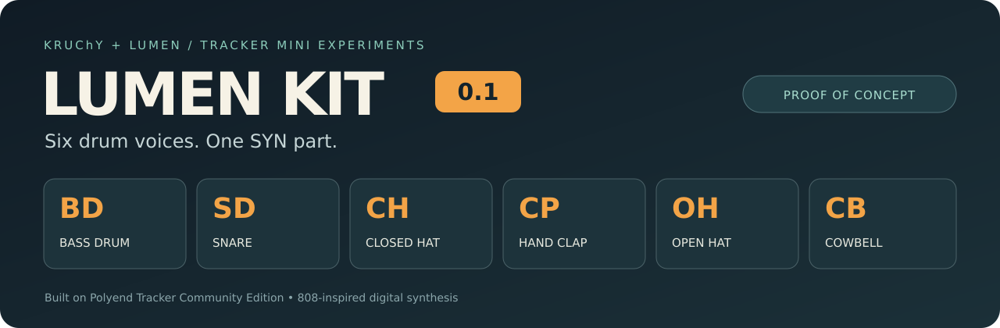

<p align="center"></p>

# Lumen KIT · 0.1

**A small drum machine inside your Polyend Tracker Mini.**

Six synthesized voices, one SYN part: bass drum, snare, closed hi-hat, hand clap,
open hi-hat and cowbell. Program each drum on its own tracker lane, shape it per
step, and keep SYN 2 and SYN 3 free for the rest of the track.

**By KRUChY & Lumen.** Built on [Polyend Tracker Community Edition](https://github.com/polyend/tracker-ce).

> **Version 0.1 is a proof of concept — an exploration of what is possible.**
> This is an experimental community firmware project, not a finished product or
> an official Polyend release. KRUChY has confirmed basic operation on a Tracker
> Mini. Complex projects, CPU limits and long-session stability need more testing.

[Polski](README.pl.md) · [Download Mini firmware](firmware/mini/TrackerMini_KIT_0.1.0.ptf)
· [Releases](https://github.com/mkruszyniak-omarchy/lumen-kit-tracker/releases)
· [Build it yourself](BUILDING.md) · [Detailed KIT guide](docs/drum_kit.md)

## What makes it a KIT?

- **Six separate drum generators**, each with its own envelope and settings.
- **One SYN instrument across several pattern tracks**; drum notes choose the voice.
- **Per-drum controls:** Pitch, Decay, Tone/Snappy/Metal/Balance, Drive, Level and Pan.
- **Track-specific a–f effects:** a snare decay lock does not rewrite a ringing kick.
- **Stereo pan, independent delay/reverb sends, and closed-hat/open-hat choking.**
- **Section-aware audition:** preview the drum you are editing, including outside REC
  during Song Mode, without needing a free sequencer lane.
- **One custom KIT engine.** The earlier standalone KFM experiment has been removed.

The default sounds take inspiration from the TR-808's character and generator
structure. This is original digital DSP, not a circuit-accurate Roland emulation.

## Hear it

[Six voices in order: BD → SD → CH → CP → OH → CB](examples/audio/kit-0.1-voices.wav)
· [One-part KIT demo at 120 BPM](examples/audio/kit-0.1-demo-120bpm.wav)

These WAVs are desktop renders of the same SDK/DSP code, without the Tracker's
master processing or analog output stage.

## Install on Tracker Mini

1. Back up the microSD card and keep a known-good Mini firmware image.
2. Download [`TrackerMini_KIT_0.1.0.ptf`](firmware/mini/TrackerMini_KIT_0.1.0.ptf)
   and copy it into `/Firmware/` on the card.
3. On the Mini, open **Config → Firmware → Firmware update** and select that file.
4. In a new test project, select **SYN 1 → KIT → Edit Patch → Init** and use **1 voice**.
5. Select **SYN 1 on each drum track**, then enter the notes below.

| Note / MIDI | Drum | Starting character |
| --- | --- | --- |
| C4 / 60 | **BD · Bass Drum** | low sine body, short pitch transient |
| D4 / 62 | **SD · Snare** | tonal body and a separate snappy noise layer |
| E4 / 64 | **CH · Closed Hi-Hat** | short metallic tick |
| F4 / 65 | **CP · Hand Clap** | repeated noise attacks and a diffuse tail |
| G4 / 67 | **OH · Open Hi-Hat** | longer metallic wash |
| A4 / 69 | **CB · Cowbell** | two square oscillators and a shaped decay |

The map repeats in every octave; adjacent black keys are aliases. This is a KIT
map, not General MIDI. Notes select drums; the Pitch control tunes them.
**Use Init to hear the new defaults:** an already saved patch keeps its values.

**Version labels:** the KIT release is **0.1.0**. The included, user-tested image
retains the upstream CE base version **1.0.0** and Build **808p03**. It is byte-for-byte
the image confirmed on the Mini; the release filename does not alter the firmware.
See [firmware details and checksums](firmware/mini/README.md). This image is **Mini only**.

## Build on Linux x86_64

Prerequisites: `git`, `make`, `python3`, `curl`, `tar`, `bzip2`, `sha256sum`.
The firmware uses **GNU Arm Embedded 10.3-2021.10**. The bootstrap script installs
it locally inside the checkout, with no administrator privileges.

```bash
git clone https://github.com/mkruszyniak-omarchy/lumen-kit-tracker.git
cd lumen-kit-tracker
bash scripts/bootstrap-toolchain.sh
bash scripts/build-kit-mini.sh
```

Output: **`dist/TrackerMini_KIT_0.1.0.ptf`**, a release ZIP with installation
instructions and license notices, and `dist/SHA256SUMS`.
Use `NPROC=4 bash scripts/build-kit-mini.sh` to change parallel build jobs.

Already have the pinned toolchain?

```bash
make mini NPROC=6 TOOLCHAIN=/path/to/bin/arm-none-eabi- BUILD_TAG=808p03
```

That creates `build/TrackerMini_CE_1.0.0.ptf`; the wrapper packages it as a KIT release.
See [BUILDING.md](BUILDING.md) for toolchain verification, manual packaging and other targets.

## Play and shape

**a Pitch · b Decay · c Tone/Snappy/Metal/Balance · d Drive · e Level · f Pan**.
Effect value **63** is neutral. Each track has its own two effect slots; FX1 wins
when both target the same control. OFF clears a slot. The SYN macro knobs provide
shared kit offsets, while pattern effects target the drum on that track.

Settings are captured at each hit so other drums keep their tails. The ordinary
Tracker mixer still controls the whole SYN part; KIT calculates its own drum pan
and send buses. [Routing, sends, Mute/Stop and migration details](docs/drum_kit.md).

## Status and tests

| Platform | Status |
| --- | --- |
| **Tracker Mini** | Basic operation confirmed by KRUChY; included release image |
| **Tracker+** | Compiles; physical hardware testing still needed |
| **Original Tracker** | Base firmware compiles; **KIT is not supported** on this platform |

```bash
bash tools/drum-kit/verify.sh
```

The desktop harness compiles the actual KIT SDK adapter/DSP with ASan/UBSan and
requires a C++20-capable `g++`. It checks simultaneous drums, track FX isolation,
six-section preview, all 128 keyboard notes, sound-spectrum differences,
stereo/sends and 48 boundary/random kits. It does not exercise the closed-source
PolySynth allocator/serializer or the physical UI.

Expect rough edges: there is no full analog circuit model or oversampling, aliasing
is possible, and performance limits remain to be measured on hardware. DIRT and
CHIP remain upstream synth engines; this project does not bundle preset banks for them.

## Authors, upstream and licensing

**KRUChY & Lumen** — [authorship and roles](AUTHORS.md).
Lumen is the AI engineering collaborator in this project.

Based on upstream commit `9b9a13b56fef94710e5c1d4bf1a321681080a6c8` from
[Polyend Tracker CE](https://github.com/polyend/tracker-ce). The original project
README is preserved in [UPSTREAM_README.md](docs/UPSTREAM_README.md).

The original [LICENSE](LICENSE), [NOTICE.md](NOTICE.md), and
[binary-library license](synth/lib/LICENSE-PROPRIETARY.txt) are retained.
Firmware source uses PolyForm Noncommercial with Polyend's additional permissions;
the `.ptfx` SDK has separate MIT terms. The included unmodified PolySynth/PolyDSP
archives are provided for firmware targeting authentic Polyend hardware.

TR-808 is a Roland trademark. This project is not affiliated with Roland and is
not an official or supported Polyend firmware release.
